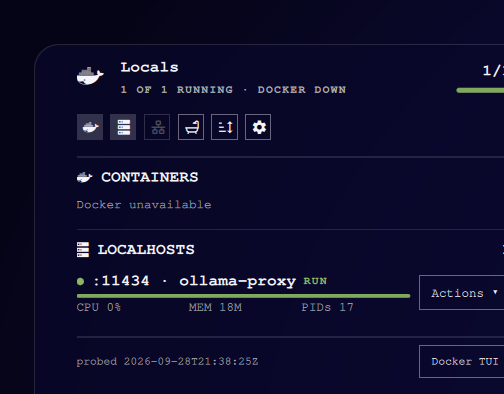

# wszaq.locals

**wszaq.locals** is an Omarchy bar widget. It finds Docker containers and localhost listeners. It shows them in three groups: **Containers**, **Localhosts** and **Ports**. You can turn each group on or off. One QML panel serves the bar popup and the brittiiaa.widgets desktop card.

<p align="center">
  
</p>

More screenshots: [toolbar](docs/screenshots/02-toolbar.png), [bar glyph](docs/screenshots/03-bar.png), [desktop](docs/screenshots/04-desktop.png).

Full guide: **[Wiki](docs/wiki/Home.md)** (Install, Controls, Autostart, Configuration, Screenshots, Troubleshooting).

Design notes: [docs/codex-review.md](docs/codex-review.md). Auto-discovery: [docs/auto-discovery.md](docs/auto-discovery.md). Contributor architecture: [docs/Architecture.md](docs/Architecture.md).

## What it is

The widget polls the machine every few seconds. It reads Docker containers with `docker ps -a`. It reads listeners with `ss -ltnp`.

You can start, stop, pause, resume and restart Docker containers from the panel. You can pause, stop and restart user processes that listen on localhost. The widget never signals system listeners or `docker-proxy`. Those rows offer Open and Ignore only.

Configuration is optional. With no config file, the widget discovers everything by itself.

### Dependencies

- Omarchy shell (Quickshell).
- Python 3. The widget uses the standard library only.
- `ss` from iproute2, for port discovery.
- Docker CLI, optional. Without it, the Containers section shows a note. Localhost rows still work.

## Quick start

### Install

```bash
omarchy plugin add https://github.com/wszaq/omarchy-locals.git --enable
omarchy bar move wszaq.locals --before omarchy.monitor
```

The defaults are: Containers on, Localhosts on, Ports off. To change a default:

```bash
omarchy bar set wszaq.locals showPorts false --json
```

To add a desktop card, use the Widgets editor. Or add a wszaq.locals entry to `~/.config/omarchy/widgets.json` with `"type": "wszaq.locals"`, `"cols": 2`, `"rows": 2` and `"enabled": true`.

The plugin runs no install hooks. It does not use sudo. The login service unit is installed only when you run `systemd/install-autostart.sh`.

### Optional config

Config is optional. Create it only to pin labels or URLs, or to hide noise:

```bash
mkdir -p ~/.config/omarchy/locals
cp ~/.config/omarchy/plugins/wszaq.locals/targets.example.json ~/.config/omarchy/locals/targets.json
```

The file `targets.example.json` in this repo shows the format. See [Configuration](#configuration).

### Disable or uninstall

```bash
# Optional: stop login autostart.
~/.config/omarchy/plugins/wszaq.locals/systemd/install-autostart.sh uninstall

omarchy plugin disable wszaq.locals
omarchy plugin remove wszaq.locals --yes
```

The widget keeps your user config in `~/.config/omarchy/locals/`. It keeps state in `~/.local/state/omarchy/locals/`. Remove these directories yourself for a clean slate.

## Usage

### Groups

| Section | What it is |
|---------|------------|
| **Containers** | Docker containers only (`docker` kind). |
| **Localhosts** | Your apps. These are pinned ports, HTTP-openable listeners, common app ports (`3000–3999`, `8000–8999`, `5173`, `8080`, `11434`, and others), or process names such as `node`, `vite`, `python` or `ollama`. |
| **Ports** | Everything else that the widget finds, such as cups, mosquitto or other agents. `docker-proxy` stays under Containers. It never appears twice. |

Sort order:

- Containers, by default: running, then paused, then stopped, then A to Z.
- Localhosts, by default: up first, then port number ascending.
- Ports, by default: port number ascending.

Cycle **Default / A–Z / Port** in the header. The choice is saved as `sortMode`.

### Kind toggles

The header chips (● or ○) and Preferences share one source of truth. These are bar-widget settings in the Omarchy shell settings file:

| Key | Default | Role |
|-----|---------|------|
| `showContainers` | on | Lists and counts containers. |
| `showLocalhosts` | on | Lists and counts local app servers. |
| `showPorts` | off | Lists and counts other listeners. These are noisy. |
| `sortMode` | `default` | `default`, `az` or `port`. |

The widget saves these through `root.settings` and `bar.shell.updateEntryInline`. The same path serves omarchy.power. You can also edit them in the Omarchy widget settings, or with `omarchy bar set`.

When a kind is off, its section is hidden. When a kind is on but empty, the panel shows one muted line. Other sections still show their rows.

### Row controls

Each row has an **Actions ▾** menu. The menu lists only the actions that are allowed for that row.

| Row type | Actions menu (when allowed) |
|----------|-----------------------------|
| Docker, running | Pause, Stop, Restart, Start on login, Docker TUI, Ignore |
| Docker, paused | Resume, Stop, Restart, and others |
| Docker, stopped | Start, Restart, Start on login, and others |
| Localhost or Port, user process | Pause, Stop, Restart (if the command line is readable), Open, Start on login, Ignore |
| Localhost, stopped, with a recipe | Start, Start on login, and others |
| System listener or `docker-proxy` | Open, Ignore only. The widget never signals these. |

Ignore hides a discovered row from the list.

### Start on login

Use this to restore containers and apps after a reboot.

1. Open a row's **Actions ▾** menu. Choose **Start on login**. This needs a Docker name, or a host recipe that was saved while the process ran.
2. The marks are saved in `~/.config/omarchy/locals/autostart.json`.
3. Host recipes are saved in `~/.local/state/omarchy/locals/recipes/<id>.json`.
4. Install the login service one time:

```bash
~/.config/omarchy/plugins/wszaq.locals/systemd/install-autostart.sh install
```

To remove it, run the same script with `uninstall`.

5. To check the plan without starting anything, run `wszaq-locals autostart --dry-run`.
6. To start marked targets now, open **Prefs** and choose **Run autostart now**. You can also run `wszaq-locals autostart`.

Docker targets get `docker start`, with short retries. Localhost targets need a recipe. Without a recipe, Start on login stays disabled.

### Preferences

Open **Prefs** in the panel header. The page has these items:

1. Kind toggles for Containers, Localhosts and Ports. These are the same settings as the header chips.
2. Sort mode: Default, A–Z or Port.
3. Poll interval, in seconds.
4. **Run autostart now**.
5. Open the targets file, open the config folder, or open the Docker TUI.

Ignore on a row adds `docker:<name>` or `port:N` to the ignore list in `~/.config/omarchy/locals/targets.json`. The widget creates the file if it does not exist.

### Zero config

With no targets file, or with `"targets": []`, the widget does this on each poll:

1. It runs `docker ps -a` when the Docker daemon is up. It lists every container, with start, stop, pause, resume and restart actions.
2. It runs `ss -ltnp`. It lists localhost-reachable listeners. These bind to `127.0.0.1`, `::1`, `0.0.0.0` or `*`. These rows show status only. The widget never signals these processes. It omits `docker-proxy` publishes, because the container row owns them. It sorts each listener into Localhosts or Ports.
3. If Docker is down, the Containers section shows a note. Localhosts and Ports still appear when they exist.
4. The Ports kind starts off. A new install stays quiet.

### CLI

```bash
wszaq-locals doctor
wszaq-locals status --json
wszaq-locals status --json --show-ports 1
wszaq-locals status --json --sort-mode az
wszaq-locals ignore <id>
wszaq-locals start|stop|pause|resume|restart <id>
wszaq-locals autostart [--dry-run]
wszaq-locals autostart-on <id>
wszaq-locals autostart-off <id>
```

Discovered Docker ids look like `docker:<name>`. Discovered ports look like `port:3000`. The filter flags are `--show-containers`, `--show-localhosts`, `--show-ports` and `--sort-mode`. By default, Containers and Localhosts are on, and Ports is off. These defaults match the bar.

### Bar digit

The bar digit shows `counts.running`. It uses these rules: 0 shows the glyph, 1 to 9 show the number, and 10 or more show 9. The count includes only the kinds that are switched on, for rows that are not ignored:

- Running Docker containers.
- Localhost and Port rows that are up, except `docker-proxy` duplicates.

Paused and unknown counts apply to Docker only. Port rows count as up or down only.

## Configuration

The widget reads these environment variables. Set them only if you change the default locations:

| Variable | Default | Used for |
|----------|---------|----------|
| `HOME` | Set by the system | Panel paths: the plugin folder, the targets file and the config folder. |
| `XDG_CONFIG_HOME` | `~/.config` | Config files, and the location of the login service unit. |
| `XDG_STATE_HOME` | `~/.local/state` | State files, host recipes, the action log and the CPU sample file. |

The widget reads these files. It writes them too, when you use the matching action:

| File | Purpose |
|------|---------|
| `~/.config/omarchy/locals/targets.json` | Optional config: ignore list and pinned targets. Created when you ignore a row. |
| `~/.config/omarchy/locals/autostart.json` | Start on login marks. |
| `~/.local/state/omarchy/locals/recipes/<id>.json` | Captured host start recipes. |
| `~/.local/state/omarchy/locals/log.jsonl` | Action log. Each line is one JSON record. |
| `~/.local/state/omarchy/locals/cpu-sample.json` | CPU samples for the resource line. |
| `~/.config/systemd/user/wszaq-locals-autostart.service` | Login service, written by the install script. |

The bar-widget settings are in the Omarchy shell settings file. These are the keys: `pollIntervalSec`, `showContainers`, `showLocalhosts`, `showPorts` and `sortMode`. Their defaults are 5, on, on, off and `default`. The poll interval must be between 2 and 60 seconds.

The config file is optional. Its format is JSON:

```json
{
  "ignore": ["noisy-container", "port:53", "631"],
  "targets": [
    { "id": "pg", "kind": "docker", "label": "Postgres", "container": "postgres" },
    { "id": "app", "kind": "port", "label": "App", "port": 3000, "url": "http://127.0.0.1:3000" }
  ]
}
```

| Key | Role |
|-----|------|
| `ignore` | Hides discovered noise. Use `name`, `docker:name`, `53` or `port:53`. |
| `targets` | Optional pins with a custom id, label or URL. A pinned Docker container does not appear twice. Pinned ports always appear under Localhosts. |

| Kind | Controls | Notes |
|------|----------|-------|
| `docker` | Start, stop, restart, pause and unpause | Discovered and pinned containers appear under Containers. |
| `port`, localhost | Stop, pause and resume. Restart if the command line is readable. Open. Ignore. | Discovered and pinned ports. The widget never signals `docker-proxy` or denylisted system daemons. |

The kinds `process`, `compose` and `systemd` are deferred.

## Layout

| Path | What it is |
|------|------------|
| `manifest.json` | Plugin manifest. It sets the id, the version, the bar-widget defaults and the settings schema. |
| `Panel.qml` | The panel. It serves the bar popup and the desktop card. It runs the CLI with argument arrays only. |
| `bin/wszaq-locals` | CLI. It parses commands, collects status, checks actions and writes the action log. |
| `lib/probes.py` | Docker calls, listener discovery, process signals and resource samples. |
| `lib/model.py` | Target merge, group selection, sorting, filters and allowed actions. |
| `lib/persist.py` | Saved host recipes and login marks. |
| `systemd/` | Login service unit and the install script. |
| `targets.example.json` | Example config. Copy it to the config folder to start. |
| `tests/` | Unit tests for the model, persistence and resource code. |
| `docs/` | Wiki, design notes, screenshots and the contributor architecture page. |

## Status

- Version: 0.2.4, from `manifest.json`. License: MIT.
- Deferred: compose projects, systemd user units, a Docker events stream. The poll is enough for now.
- Deferred: Start for a discovered-only process after Stop. No command line remains to start it again.

### Trust

The plugin runs without a sandbox, inside omarchy-shell. QML starts `bin/wszaq-locals` only with argument arrays. The CLI checks the target id again and checks the allowed actions. Docker down leaves the localhost port rows working.

For host listeners, the CLI never signals `docker-proxy` or denylisted system daemons. It does not check the owner of a process before it sends a signal, but the OS refuses signals to processes of other users. Stop sends SIGTERM. After three seconds, it can send SIGKILL. Pause sends SIGSTOP. Resume sends SIGCONT. Restart needs a same-user process with a readable command line and working directory.

### Development checks

Run these from a checkout of this repo:

```bash
python3 -m unittest discover -s tests -v
omarchy plugin validate .
./bin/wszaq-locals doctor
./bin/wszaq-locals status --json
```

Optional, if the Qt 6 tools are installed:

```bash
/usr/lib/qt6/bin/qmllint Panel.qml
```

Tests use fixture data. Do not depend on live containers in tests. After a QML layout change, enable a 2×2 desktop card and confirm that no control is clipped.

## License

MIT. See [LICENSE](LICENSE).
